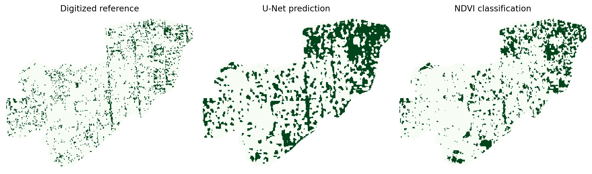

# Tree Canopy Mapping in Badda, Dhaka

I tested a small U-Net model for mapping tree canopy in Badda using
2021 Sentinel-2 imagery and digitized canopy polygons.

## Data

- Sentinel-2 surface reflectance from Google Earth Engine
- Blue, Green, Red, NIR and NDVI bands
- Digitized 2021 tree canopy reference
- 10 m spatial resolution

## Method

I divided the study area into spatially separated training,
validation and test regions. I trained a small U-Net in PyTorch
using data augmentation and early stopping.

I also compared the model with an NDVI threshold classifier.

## Results

| Model | Precision | Recall | F1 | IoU |
|---|---:|---:|---:|---:|
| U-Net | 0.254 | 0.815 | 0.387 | 0.240 |
| NDVI | 0.305 | 0.681 | 0.421 | 0.267 |

The NDVI baseline performed better in F1 and IoU.

## Limitations

Sentinel-2 has a 10 m resolution, which limits detailed mapping
of small urban tree crowns. The model was tested in one ward,
and the test region was examined during earlier experiments,
so these results are exploratory.

The imagery and original canopy polygons are not included.
